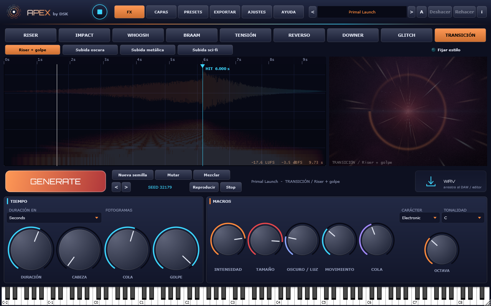
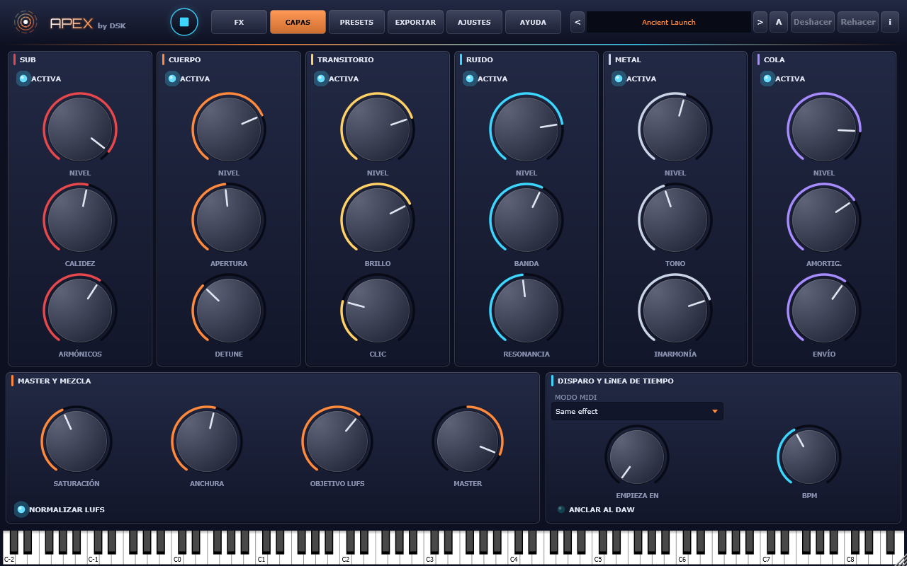
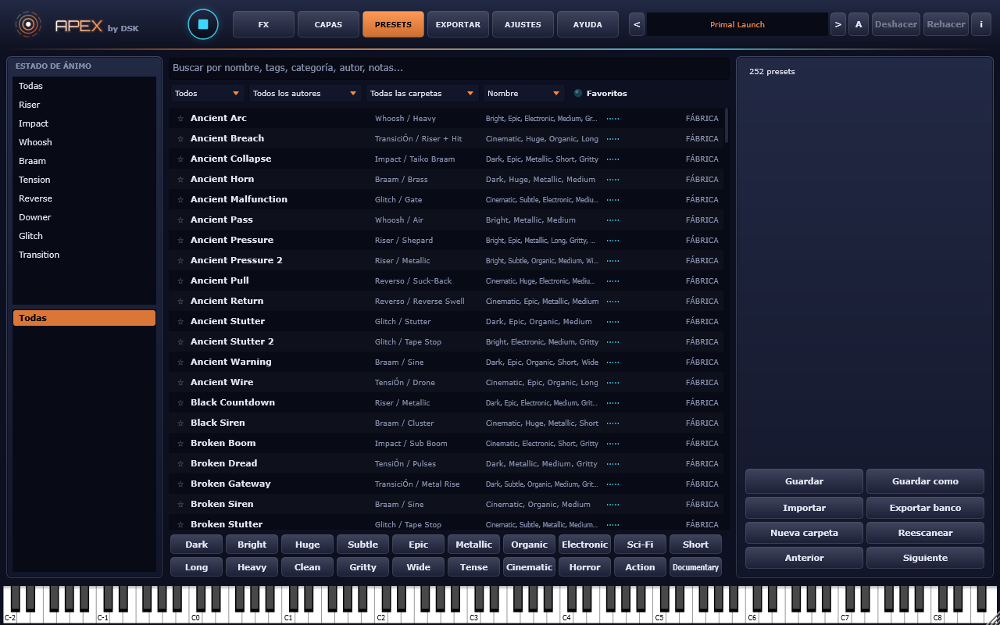
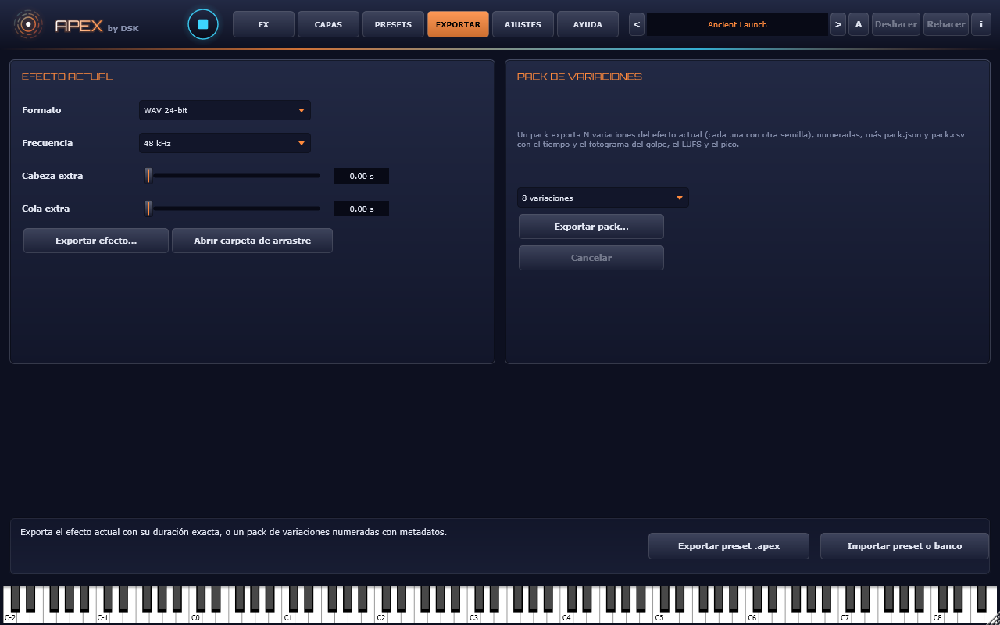
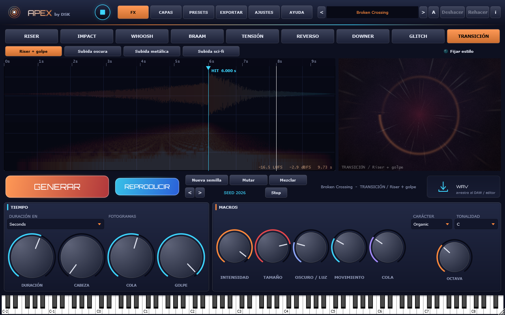

# Apex by DSK
**Efectos de tráiler y diseño de sonido cinematográfico con un botón: sintetizados, nunca iguales.**
Instrumento gratuito VST3 / AU / Standalone de [DSK Music](https://www.dskmusic.com/apex/) para editores de vídeo, YouTubers, compositores de tráiler, desarrolladores de juegos y podcasters.

**[Descargar](#descarga)** · [Página del producto](https://www.dskmusic.com/apex/) · [Última versión](https://github.com/dskmusic/apex-by-dsk/releases/latest)

Elige un tipo, pulsa **GENERATE** y obtén un riser, impacto, whoosh, braam, cama de tensión, reverso, downer, glitch o transición listo para usar. Todo se genera por síntesis (sin librerías de muestras), así que cada efecto es distinto, el plugin casi no pesa y nadie tiene que comprar una librería entera.



## Características
- **9 tipos de efecto, 4 estilos cada uno:** Riser (tonal, ruido, Shepard, metálico), Impact (boom grave, metal, tambores de tráiler, taiko braam), Whoosh (rápido, pesado, sci-fi, aire), Braam (metales, oscuro, cluster, sinusoidal), Tensión (cluster, cuerdas, pulsos, drone), Reverso (crash inverso, suck-back, swell, golpe inverso), Downer / Drop, Glitch / Stutter (stutter, bit crush, tape stop, gate) y Transición (riser + golpe en un solo efecto).
- **Duración exacta, golpe exacto:** escribe la subida en **segundos**, en **tiempos** (sigue el tempo de tu DAW) o en **fotogramas** (24 / 25 / 30 / 60 fps). El clímax cae *exactamente* en el **punto de golpe**; la regla de la línea de tiempo lo muestra en segundos, compases o fotogramas. Añade una cabeza (silencio previo) y elige la cola.
- **Seis macros grandes:** Intensidad, Tamaño (de habitación a estadio), Oscuro / Luz, Movimiento estéreo, Cola y Carácter (orgánico, metálico, electrónico, sci-fi), más tonalidad y octava para los elementos tonales.
- **Seis capas visibles:** Sub, Cuerpo, Transitorio, Ruido, Metal y Cola, cada una con activar, nivel, tono y carácter.
- **Determinista por semilla:** misma semilla = mismo sonido, siempre; el bounce del DAW es idéntico a lo que oíste. Nueva semilla, **Mutar** y **Mezclar** dan variaciones sin fin.
- **Dispáralo como quieras:** botón Play, cualquier nota MIDI (o *una variación distinta por nota*), o **ancla a la línea de tiempo del DAW** para que el efecto siga la posición del host desde el tiempo que elijas.
- **Arrástralo:** arrastra el efecto como **WAV** directamente a tu DAW o editor de vídeo (Premiere, DaVinci Resolve, CapCut…). Exporta WAV / FLAC / OGG a 44,1 / 48 / 96 kHz con cabeza y cola, o un **pack** de N variaciones numeradas con metadatos `pack.json` / `pack.csv` (tiempo y fotograma del golpe, LUFS, pico).
- **Nivel seguro para vídeo:** volumen normalizado a un objetivo LUFS (-18 por defecto) con limitador de pico a -1 dBFS; sin DC ni chasquidos (se comprueba automáticamente).
- **Forma de onda + espectrograma** con el punto de golpe, regla y cabezal, y un **visual cinematográfico por GPU** (ondas de choque, haces de luz convergentes, destello anamórfico) que reacciona al efecto.
- **252 efectos de fábrica**, validados y con el nivel igualado; navegador de presets con etiquetas, favoritos y valoraciones, A/B, deshacer/rehacer, MIDI learn.
- Redimensionable y maximizable, interfaz **English / Español** (automática o manual) y página de Ayuda integrada.

| | |
|---|---|
|  |  |
|  |  |

## Descarga
**Página del producto:** https://www.dskmusic.com/apex/

| Sistema | Recomendado | Otros formatos |
|---|---|---|
| **Windows** 10/11 (64 bits) | [Instalador (.exe)](https://github.com/dskmusic/apex-by-dsk/releases/latest/download/Apex-by-DSK-win-x64-setup.exe) | [VST3 (zip)](https://github.com/dskmusic/apex-by-dsk/releases/latest/download/Apex-by-DSK-win-x64-vst3.zip) · [Standalone (zip)](https://github.com/dskmusic/apex-by-dsk/releases/latest/download/Apex-by-DSK-win-x64-standalone.zip) |
| **macOS** 11+ (Universal: Apple Silicon + Intel) | [Instalador (.pkg)](https://github.com/dskmusic/apex-by-dsk/releases/latest/download/Apex-by-DSK-macos-universal-installer.pkg) | [VST3](https://github.com/dskmusic/apex-by-dsk/releases/latest/download/Apex-by-DSK-macos-universal-vst3.zip) · [AU](https://github.com/dskmusic/apex-by-dsk/releases/latest/download/Apex-by-DSK-macos-universal-au.zip) · [Standalone](https://github.com/dskmusic/apex-by-dsk/releases/latest/download/Apex-by-DSK-macos-universal-standalone.zip) |
| **Linux** x86_64 | [VST3 (tar.gz)](https://github.com/dskmusic/apex-by-dsk/releases/latest/download/Apex-by-DSK-linux-x64-vst3.tar.gz) | [Standalone (tar.gz)](https://github.com/dskmusic/apex-by-dsk/releases/latest/download/Apex-by-DSK-linux-x64-standalone.tar.gz) |

Todos los archivos y notas de la versión: [última versión](https://github.com/dskmusic/apex-by-dsk/releases/latest) · sumas de verificación: [SHA256SUMS.txt](https://github.com/dskmusic/apex-by-dsk/releases/latest/download/SHA256SUMS.txt)

Los binarios no están firmados. **Windows:** aparece SmartScreen, pulsa *Más información* → *Ejecutar de todas formas*.
**macOS:** si el instalador "no se puede abrir" o "está dañado", clic derecho → *Abrir*, o ejecuta `xattr -dr com.apple.quarantine <archivo>` en Terminal.

### Instalación
- **Instalador de Windows:** instala el VST3 en `C:\Program Files\Common Files\VST3` y la app Standalone.
- **Instalador de macOS:** instala VST3, AU y la app Standalone. Reescanea los plugins en tu DAW (Logic: AU Manager).
- **Manual:** copia `Apex by DSK.vst3` a tu carpeta VST3 (`~/.vst3` en Linux).

### Inicio rápido
1. Carga **Apex** como instrumento (o abre el Standalone) y pulsa **Play**.
2. Elige un **tipo** y un **estilo** y pulsa **GENERATE** (o **G**). Ajusta la duración y el punto de golpe.
3. Arrastra el icono **WAV** a tu DAW / editor de vídeo, o usa la página **Exportar**.

Los presets y ajustes se guardan en `Documentos/DSK Music/Apex/`.

## Compilar desde el código
Requisitos: CMake 3.22+, un compilador C++20 (Visual Studio 2022, Xcode 15 o GCC 11+) y Ninja. JUCE 8 se descarga automáticamente.

```bash
./build_local.sh Release            # macOS / Linux
build_local.bat Release             # Windows
```

## Licencia
GNU GPL v3, ver [LICENSE](LICENSE). Construido con [JUCE](https://juce.com) (GPLv3) y la fuente Orbitron (SIL OFL 1.1).
