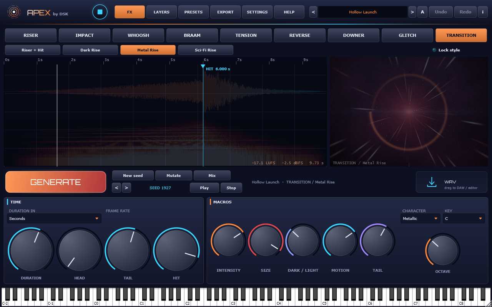
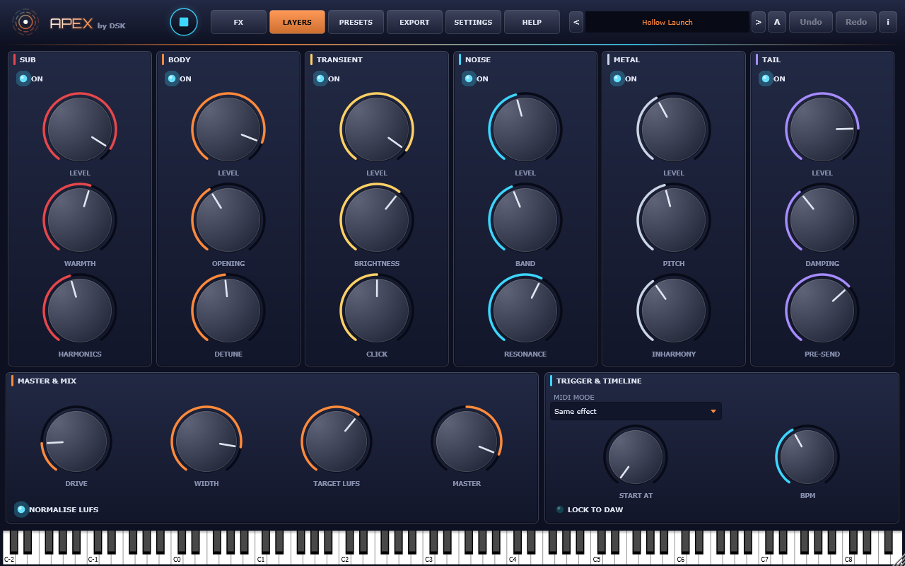
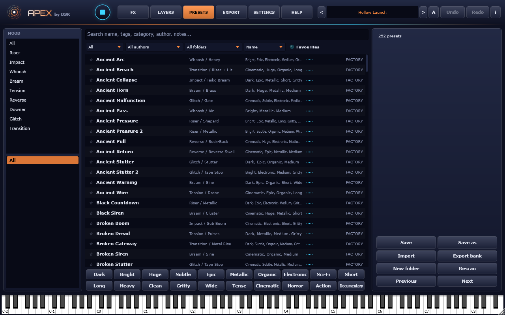
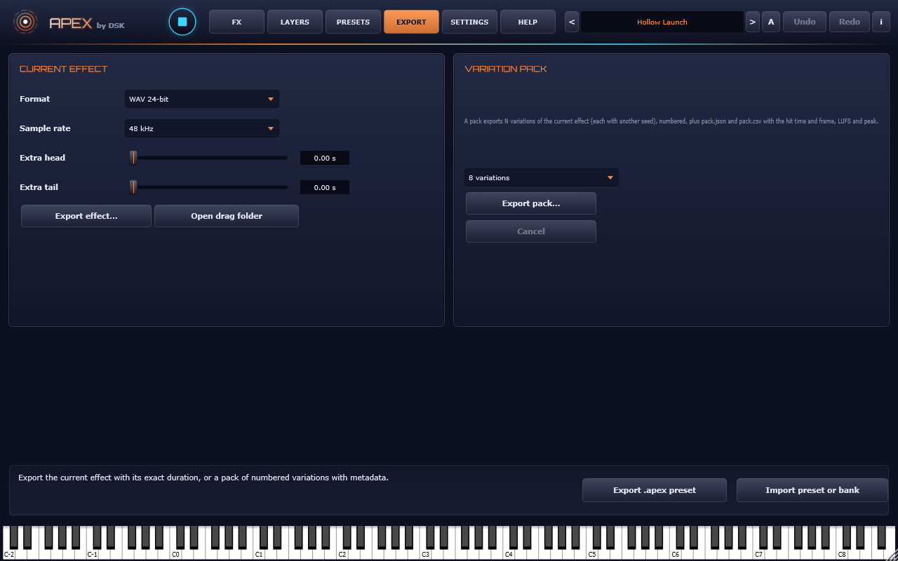
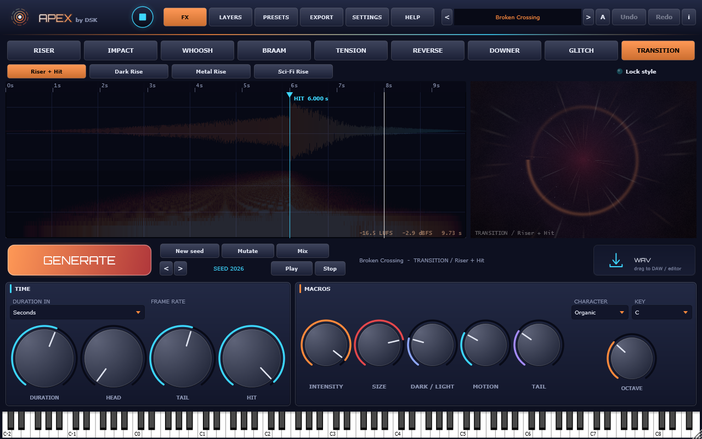

# Apex by DSK
**One-button trailer effects and cinematic sound design — synthesised, never the same twice.**
Free VST3 / AU / Standalone instrument by [DSK Music](https://www.dskmusic.com/apex/) for video editors, YouTubers, trailer composers, game developers and podcasters.

**[Download](#download)** · [Product page](https://www.dskmusic.com/apex/) · [Latest release](https://github.com/dskmusic/apex-by-dsk/releases/latest)

Pick a type, press **GENERATE**, and get a ready-to-use risers, impact, whoosh, braam, tension bed, reverse, downer, glitch or transition — built by synthesis (no sample libraries), so every effect is different, the plugin weighs almost nothing, and nobody has to buy a whole library.



## Features
- **9 effect types, 4 styles each:** Riser (tonal, noise, Shepard, metallic), Impact (sub boom, metal, trailer drums, taiko braam), Whoosh (fast, heavy, sci-fi, air), Braam (brass, dark, cluster, sine), Tension (cluster, strings, pulses, drone), Reverse (reverse crash, suck-back, swell, reverse hit), Downer / Drop, Glitch / Stutter (stutter, bit crush, tape stop, gate) and Transition (riser + hit in one effect).
- **Exact duration, exact hit:** enter the build in **seconds**, in **beats** (follows your DAW tempo) or in **frames** (24 / 25 / 30 / 60 fps). The climax lands *exactly* on the **Hit Point**; a timeline ruler shows it in seconds, bars or frames. Add a head (silence before) and choose the tail.
- **Six big macros:** Intensity, Size (room to stadium), Dark / Light, Stereo Motion, Tail and Character (organic, metallic, electronic, sci-fi), plus key and octave for the tonal elements.
- **Six visible layers:** Sub, Body, Transient, Noise, Metal and Tail — each with on/off, level, tone and character.
- **Deterministic by seed:** same seed = the same sound, always, so a DAW bounce is bit-identical to what you heard. New seed, **Mutate** and **Mix** give endless variations.
- **Trigger it your way:** the Play button, any MIDI note (or *a different variation per note*), or **lock to the DAW timeline** so the effect follows the host position from the beat you choose.
- **Drag it out:** drag the effect as a **WAV** straight into your DAW or video editor (Premiere, DaVinci Resolve, CapCut…). Export WAV / FLAC / OGG at 44.1 / 48 / 96 kHz with head and tail, or a **pack** of N numbered variations with `pack.json` / `pack.csv` metadata (hit time and frame, LUFS, peak).
- **Video-safe level:** loudness normalised to a LUFS target (-16 by default, measured on the loudest 3 seconds so a long tail never makes the hit quieter) with a -1 dBFS brick-wall limiter; no DC, no clicks (checked automatically).
- **Waveform + spectrogram** with the Hit Point, ruler and playhead, and a **GPU cinematic visual** (shock waves, converging light streaks, anamorphic flare) that reacts to the effect.
- **252 factory effects**, validated and level-matched; preset browser with tags, favourites and ratings, A/B, undo/redo, MIDI learn.
- Resizable, maximisable, **English / Español** interface (automatic or manual) and a friendly built-in Help page.

| | |
|---|---|
|  |  |
|  |  |

## Download
**Product page:** https://www.dskmusic.com/apex/

| System | Recommended | Other formats |
|---|---|---|
| **Windows** 10/11 (64-bit) | [Installer (.exe)](https://github.com/dskmusic/apex-by-dsk/releases/latest/download/Apex-by-DSK-win-x64-setup.exe) | [VST3 (zip)](https://github.com/dskmusic/apex-by-dsk/releases/latest/download/Apex-by-DSK-win-x64-vst3.zip) · [Standalone (zip)](https://github.com/dskmusic/apex-by-dsk/releases/latest/download/Apex-by-DSK-win-x64-standalone.zip) |
| **macOS** 11+ (Universal: Apple Silicon + Intel) | [Installer (.pkg)](https://github.com/dskmusic/apex-by-dsk/releases/latest/download/Apex-by-DSK-macos-universal-installer.pkg) | [VST3](https://github.com/dskmusic/apex-by-dsk/releases/latest/download/Apex-by-DSK-macos-universal-vst3.zip) · [AU](https://github.com/dskmusic/apex-by-dsk/releases/latest/download/Apex-by-DSK-macos-universal-au.zip) · [Standalone](https://github.com/dskmusic/apex-by-dsk/releases/latest/download/Apex-by-DSK-macos-universal-standalone.zip) |
| **Linux** x86_64 | [VST3 (tar.gz)](https://github.com/dskmusic/apex-by-dsk/releases/latest/download/Apex-by-DSK-linux-x64-vst3.tar.gz) | [Standalone (tar.gz)](https://github.com/dskmusic/apex-by-dsk/releases/latest/download/Apex-by-DSK-linux-x64-standalone.tar.gz) |

All files and release notes: [latest release](https://github.com/dskmusic/apex-by-dsk/releases/latest) · checksums: [SHA256SUMS.txt](https://github.com/dskmusic/apex-by-dsk/releases/latest/download/SHA256SUMS.txt)

The binaries are not code-signed. **Windows:** SmartScreen appears, click *More info* → *Run anyway*.
**macOS:** if the installer "can't be opened" or is "damaged", right-click it → *Open*, or run `xattr -dr com.apple.quarantine <file>` in Terminal.

### Install
- **Windows installer:** installs the VST3 to `C:\Program Files\Common Files\VST3` and the Standalone app.
- **macOS installer:** installs VST3, AU and the Standalone app. Rescan plugins in your DAW (Logic: AU Manager).
- **Manual:** copy `Apex by DSK.vst3` to your VST3 folder (`~/.vst3` on Linux).

### Quick start
1. Load **Apex** as an instrument (or open the Standalone) and press **Play**.
2. Pick a **type** and a **style** and press **GENERATE** (or **G**). Set the duration and the Hit Point.
3. Drag the **WAV** handle into your DAW / video editor, or use the **Export** page.

Presets and settings are stored in `Documents/DSK Music/Apex/`.

## Build from source
Requirements: CMake 3.22+, a C++20 compiler (Visual Studio 2022, Xcode 15 or GCC 11+) and Ninja. JUCE 8 is downloaded automatically.

```bash
./build_local.sh Release            # macOS / Linux
build_local.bat Release             # Windows
```

`ApexTool` (built alongside) runs the unit tests (`ApexTool test`), renders effects for listening (`ApexTool render out.wav Impact 0 42`), regenerates the factory bank (`ApexTool factory`) and the screenshots.

## License
GNU GPL v3 — see [LICENSE](LICENSE). Built with [JUCE](https://juce.com) (GPLv3) and the Orbitron font (SIL OFL 1.1).
